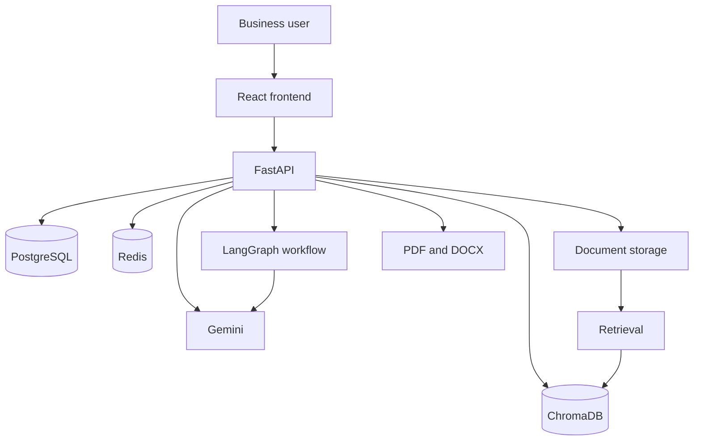

# ProposalGenie

ProposalGenie helps a company turn its own documents and a client request into a reviewed proposal, a budget, and a PDF or Word file.

People spend hours rewriting the same company facts, checking prices, and formatting a proposal. This application keeps those facts in a company workspace, retrieves them when a proposal is written, and records who edited, approved, and exported the result.

## Features

- Accounts with Argon2 password hashes and expiring JWT access tokens. Logout invalidates older tokens.
- Companies, memberships, and clients. Members of one company cannot read another company's data.
- PDF, DOCX, TXT, and Markdown upload, text extraction, and Chroma retrieval.
- Gemini proposal generation and a LangGraph workflow with a bounded review loop.
- Section editing, autosave, version history, and restore that keeps older versions.
- Decimal cost estimates. AI suggestions stay estimated until a person confirms them.
- Approval workflow with an audit trail.
- PDF and DOCX export for proposals in review, approved, or sent.
- Dashboard counts, monthly trends, status distribution, and budgets separated by currency.

## Architecture



A longer description of tenants, agents, and backups is in [docs/architecture/overview.md](docs/architecture/overview.md).

## Technology stack

| Area | Choice |
| --- | --- |
| Frontend | React 18, TypeScript, Vite, Tailwind CSS, Recharts |
| Backend | Python 3.12, FastAPI, Pydantic, SQLAlchemy, Alembic |
| Database | PostgreSQL 16 |
| Cache and rate limits | Redis 7 |
| Vectors | ChromaDB, sentence-transformers `all-MiniLM-L6-v2` |
| Proposal model | Google Gemini |
| Agent workflow | LangGraph |
| Documents | PyMuPDF, python-docx, ReportLab |
| Tests | pytest, httpx |
| Deployment | Docker Compose, nginx |

## Folder structure

```text
backend/app/api            HTTP routes under /api/v1
backend/app/services       Application use cases
backend/app/models         SQLAlchemy models
backend/app/agents         LangGraph workflow
backend/app/rag            Chunking, Chroma, and answers
backend/app/exports        PDF and DOCX rendering
backend/alembic            Schema migrations
backend/tests              Automated tests
frontend/src               React application
docs/architecture          Architecture and backup notes
docker-compose.yml         Postgres, Redis, API, and web
```

## Setup

Prerequisites: Python 3.12, Node.js, Docker Desktop, and Git.

```powershell
git clone https://github.com/praveen0815/AI-Based-ProposalGenie.git
cd "AI-Based ProposalGenie"
copy .env.example .env
```

Edit `.env` before use. Replace `JWT_SECRET`, `POSTGRES_PASSWORD`, and `REDIS_PASSWORD`. Leave `GEMINI_API_KEY` empty until you want live generation. The React app never receives that key.

Start the databases:

```powershell
docker compose up -d postgres redis
```

Backend:

```powershell
cd backend
py -3.12 -m venv .venv
.\.venv\Scripts\Activate.ps1
pip install -r requirements.txt
alembic upgrade head
uvicorn app.main:app --host 127.0.0.1 --port 8000
```

Frontend, in another terminal:

```powershell
cd frontend
npm install
npm run dev
```

Open `http://localhost:5173`. The API is `http://127.0.0.1:8000`. Interactive API docs are at `http://127.0.0.1:8000/docs`.

`alembic upgrade head` applies every migration, including on a database created in an earlier phase. It does not drop tables or volumes.

## Environment variables

The root `.env.example` lists every variable. Important ones:

| Variable | Purpose |
| --- | --- |
| `POSTGRES_HOST`, `POSTGRES_PASSWORD`, `POSTGRES_DB` | Database connection |
| `REDIS_HOST`, `REDIS_PASSWORD` | Redis connection |
| `JWT_SECRET` | HMAC secret, at least 32 characters |
| `ACCESS_TOKEN_EXPIRE_MINUTES` | Access-token lifetime |
| `CORS_ORIGINS` | Allowed browser origins |
| `DOCUMENT_STORAGE_PATH`, `CHROMA_PATH` | Private file and vector directories |
| `MAX_UPLOAD_BYTES` | Upload limit |
| `GEMINI_API_KEY`, `GEMINI_MODEL` | Proposal generation. Empty key disables live calls |
| `RESEARCH_API_KEY`, `RESEARCH_BASE_URL` | Optional external research. Both must be set |
| `RATE_LIMIT_*` | Per-IP request limits |
| `VITE_API_BASE_URL` | Frontend API origin. Empty in the Docker web image so nginx proxies `/api` |

There is no refresh token. Logout increments `token_version`, which rejects access tokens issued before logout.

## Docker

Local development uses only Postgres and Redis, as shown above. The API container then uses the service names `postgres` and `redis`, not `localhost`.

Full stack, including the API and the nginx frontend on port 8080:

```powershell
docker compose up -d --build
```

Named volumes keep PostgreSQL data, Redis, uploaded documents, and Chroma data across restarts. The API container runs `alembic upgrade head` before Uvicorn. See [docs/architecture/overview.md](docs/architecture/overview.md) for backup and restore.

## Database migrations

```powershell
cd backend
.\.venv\Scripts\alembic.exe upgrade head
.\.venv\Scripts\alembic.exe current
```

Create a new revision only when a model changes:

```powershell
.\.venv\Scripts\alembic.exe revision --autogenerate -m "describe the change"
```

Inspect the generated file before upgrading. Enum check constraints sometimes need a manual edit.

## API

All JSON routes are under `/api/v1`. Errors use `{ "error", "message", "details" }`.

| Area | Routes |
| --- | --- |
| Health | `GET /health`, `GET /api/v1/health`, `GET /api/v1/ready` |
| Auth | `POST /api/v1/auth/register`, `/login`, `/logout`, `GET /me` |
| Companies | `GET/POST /api/v1/companies`, members and profile updates |
| Knowledge | `POST /api/v1/knowledge/documents/upload`, list, status, reprocess, delete |
| RAG | `POST /api/v1/rag/search`, `POST /api/v1/rag/query` |
| Proposals | `GET/POST /api/v1/proposals`, `POST /{id}/generate` |
| Editing | `PUT /{id}/draft`, versions, compare, restore, section regenerate |
| Costs | `GET/PUT /{id}/costs`, suggest, confirm |
| Approval | `GET/POST /{id}/approval` |
| Agents | `POST/GET /api/v1/agents/proposals/{id}/run`, status, history, resume |
| Export | `POST /{id}/export/pdf`, `POST /{id}/export/docx`, list, download |
| Dashboard | `GET /api/v1/dashboard/summary`, `/proposal-trends`, `/status-distribution` |

## RAG workflow

1. A member uploads a company document.
2. The file type is checked from its contents, text is extracted, and the text is split into chunks.
3. Chunks are embedded and upserted into Chroma with the company and document ids.
4. A question or proposal request embeds the query and keeps chunks above the similarity threshold.
5. The model sees those excerpts as untrusted data and is told to use only that evidence.
6. If no chunk qualifies, the answer says the documents do not contain enough information.

Reprocessing a document upserts the same chunk ids, so indexing a document again does not create a second copy.

## Multi-agent workflow

`POST /api/v1/agents/proposals/{id}/run` starts requirement analysis, research, solution design, writing, quality review, and finalization. Review can loop back to the writer until the configured iteration limit. Progress is stored in `agent_runs` and `agent_events`. A failed run can be resumed without creating a second proposal. One running workflow is allowed per proposal.

External research runs only when `RESEARCH_API_KEY` and `RESEARCH_BASE_URL` are both set. Otherwise the research step records `not_configured`.

## Screenshots

Add product screenshots here before a public release:

- `docs/images/dashboard.png` — analytics for a company with proposals
- `docs/images/proposal-editor.png` — section editor, versions, and budget
- `docs/images/export.png` — PDF and DOCX download

## Testing

Backend tests use PostgreSQL and Redis from Docker, temporary files, and fake Gemini and research clients. They do not call Google.

```powershell
cd backend
.\.venv\Scripts\python.exe -m pytest -v
```

The suite includes authentication, tenant isolation, documents, RAG, mocked proposal generation, the agent workflow, costs, versions, PDF/DOCX, the dashboard, and rate-limit behavior.

Frontend production build:

```powershell
cd frontend
npm run build
```

There is no frontend unit-test runner. `npm run build` is the typecheck and production bundle.

A live Gemini call is not part of `pytest`. It runs only when a person starts generation with `GEMINI_API_KEY` set.

## Security

- Passwords are hashed with Argon2. Tokens are HS256 JWTs with an expiry and a version check.
- Company isolation is enforced in queries. Non-members receive 404.
- Uploads are size-limited, extension-checked, and content-checked. Storage keys reject path traversal.
- SQL is built with SQLAlchemy expressions, not string-concatenated queries.
- CORS allows only configured origins. Responses set `nosniff`, `DENY` framing, and `no-referrer`.
- Redis rate limits auth, writes, reads, and expensive generation routes. If Redis is down, the request proceeds and `/api/v1/ready` reports Redis as down.
- Logs pass through secret redaction. Error responses do not include stack traces.
- Agent tools cannot receive a company id, SQL, or a shell command from the model. Retrieved text and user text are fenced as untrusted.
- Export and document operations require the caller's company membership. Export responses do not include filesystem paths.
- Audit log lines record the action and ids for registration, login, logout, upload, generation, agent start, approval, and export.

## Known limitations

- There is no refresh token. The access token is the only credential issued to the browser.
- There is no logo upload screen. A PDF includes a logo only when `companies.logo_storage_key` already points at a stored image.
- External research is optional and off by default.
- The first retrieval can download the embedding model into the local cache.
- Rate limits are per IP address, not per user.
- The Docker API image is large because it includes the embedding stack.
- The product has not been click-tested in a browser as part of the automated suite.

## Future enhancements

- Refresh tokens and server-side session listing.
- A company logo upload that sets `logo_storage_key`.
- Background workers if generation volume outgrows the request cycle.
- Per-user rate limits and stricter production CSP for the web app.
- Email delivery of an approved proposal.

## GitHub release checklist

- [ ] `.env` is not tracked, and `.env.example` contains only placeholder secrets.
- [ ] `storage/`, `.venv/`, and `node_modules/` are ignored.
- [ ] `alembic upgrade head` succeeds on a copy of the existing database without deleting rows.
- [ ] `pytest -v` passes.
- [ ] `npm run build` passes.
- [ ] `docker compose config` succeeds.
- [ ] Screenshots are added or the placeholders above stay marked as pending.
- [ ] `GEMINI_API_KEY` in any shared example is empty.
