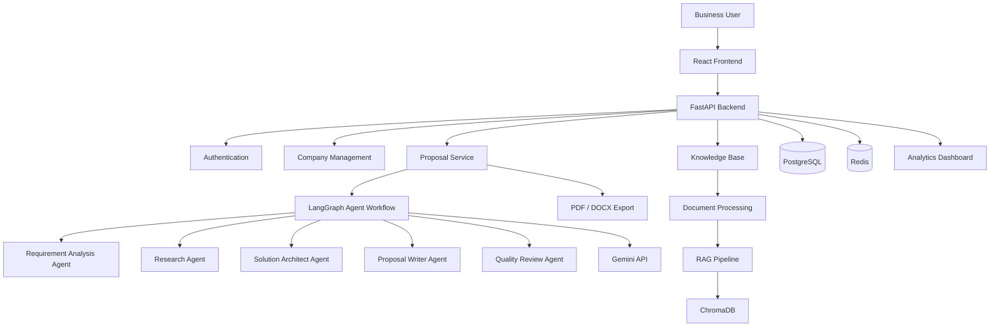

# ProposalGenie – AI-Powered Business Proposal Generator

**Generate smarter business proposals with Generative AI, RAG, and Multi-Agent Systems.**

ProposalGenie is an AI-powered business proposal generation platform designed to help businesses create structured, professional, and personalized proposals using company knowledge, client requirements, and intelligent AI workflows.

The platform aims to combine Large Language Models (LLMs), Retrieval-Augmented Generation (RAG), and AI Agents to streamline the business proposal creation process.

---

## 🚀 Project Overview

Creating professional business proposals requires time, research, company knowledge, cost estimation, and careful documentation.

ProposalGenie aims to simplify this process through an intelligent platform that can:

- Understand client requirements.
- Analyze company information.
- Retrieve relevant business knowledge.
- Generate customized proposals.
- Review and improve proposal content.
- Produce professional PDF and DOCX documents.

The long-term goal is to build an intelligent proposal management system rather than a basic AI text generator.

## 🏗️ System Architecture

The following diagram represents the planned full application architecture. Only the foundation and service connectivity are implemented currently.



## 🛠️ Technology Stack

| Category | Technologies |
|---|---|
| Frontend | React, TypeScript, Vite |
| UI Styling | Tailwind CSS |
| Backend | Python 3.12, FastAPI |
| Validation | Pydantic |
| ORM | SQLAlchemy |
| Database Migrations | Alembic |
| Database | PostgreSQL 16 |
| Caching | Redis 7 |
| Infrastructure | Docker, Docker Compose |
| Testing | Pytest, HTTPX |
| LLM – Planned | Google Gemini |
| RAG – Planned | ChromaDB, Sentence Transformers |
| AI Orchestration – Planned | LangGraph, LangChain |
| Document Export – Planned | ReportLab, python-docx |

## 📂 Project Structure

```text
AI-Based ProposalGenie/
│
├── backend/
│   ├── app/
│   │   ├── api/
│   │   │   └── v1/
│   │   │       └── endpoints/
│   │   │
│   │   ├── core/
│   │   ├── database/
│   │   ├── models/
│   │   ├── schemas/
│   │   ├── repositories/
│   │   ├── services/
│   │   ├── agents/
│   │   ├── rag/
│   │   ├── integrations/
│   │   ├── middleware/
│   │   └── main.py
│   │
│   ├── alembic/
│   ├── tests/
│   ├── requirements.txt
│   └── .env
│
├── frontend/
│   ├── src/
│   │   ├── components/
│   │   ├── pages/
│   │   ├── layouts/
│   │   ├── hooks/
│   │   ├── services/
│   │   ├── types/
│   │   ├── utils/
│   │   ├── App.tsx
│   │   └── main.tsx
│   │
│   └── package.json
│
├── infrastructure/
│   └── docker/
│
├── docs/
│   └── architecture/
│
├── docker-compose.yml
├── .env.example
├── .gitignore
└── README.md
```

*Note: This represents the intended project organization. Individual directories and modules will be added as development progresses.*

## ⚙️ Getting Started

### Prerequisites

- Python 3.12
- Node.js and npm
- Git
- Docker Desktop
- PowerShell (Windows)

### 1. Clone the Repository

```powershell
git clone https://github.com/praveen0815/AI-Based-ProposalGenie.git

cd "AI-Based ProposalGenie"
```

### 2. Configure Environment Variables

Copy the example environment file:

```powershell
copy .env.example .env
```

Configure the required local credentials in `.env`.

The backend uses its own environment configuration in `backend/.env`.

Do not commit real credentials or API keys.

### 3. Start PostgreSQL and Redis

```powershell
docker compose up -d
```

Check container status:

```powershell
docker compose ps
```

Wait until PostgreSQL and Redis report healthy.

### 4. Backend Setup

```powershell
cd backend

py -3.12 -m venv .venv

.\.venv\Scripts\Activate.ps1

pip install -r requirements.txt
```

Run migrations:

```powershell
alembic upgrade head
```

Start FastAPI:

```powershell
uvicorn app.main:app --reload --host 127.0.0.1 --port 8000
```

### 5. Frontend Setup

Open another terminal:

```powershell
cd frontend

npm install

npm run dev
```

## 🌐 Application URLs

| Service | URL |
|---|---|
| Frontend Dashboard | http://127.0.0.1:5173 |
| FastAPI Backend | http://127.0.0.1:8000 |
| API Documentation | http://127.0.0.1:8000/docs |
| ReDoc | http://127.0.0.1:8000/redoc |
| Health Check | http://127.0.0.1:8000/health |
| API Readiness | http://127.0.0.1:8000/api/v1/ready |

## 🔗 Current API Endpoints

| Method | Endpoint | Description |
|---|---|---|
| GET | `/health` | Application liveness |
| GET | `/api/v1/health` | Application and dependency health |
| GET | `/api/v1/ready` | Readiness check |

The health endpoints monitor PostgreSQL and Redis connectivity.

## 🧪 Testing

Run backend tests:

```powershell
cd backend

pytest -v
```

Build the frontend:

```powershell
cd frontend

npm run build
```

### Phase 1 Validation

| Component | Status |
|---|---|
| FastAPI Application | Completed |
| React Dashboard | Completed |
| PostgreSQL | Healthy |
| Redis | Healthy |
| Database Connectivity | Verified |
| Redis Connectivity | Verified |
| CORS Configuration | Verified |
| Backend Tests | 20 Passed |
| Frontend Production Build | Successful |
| Responsive UI | Verified |


## 🧠 Planned Multi-Agent Architecture

ProposalGenie will eventually use specialized AI agents:

| Agent | Responsibility |
|---|---|
| Requirement Analysis Agent | Understand client requirements |
| Research Agent | Gather relevant business and project information |
| Solution Architect Agent | Design the proposed solution |
| Proposal Writer Agent | Generate structured proposal sections |
| Quality Review Agent | Evaluate completeness and consistency |
| Finalization Agent | Assemble the final proposal |

LangGraph will coordinate the agents through a controlled workflow with review and revision cycles.

## 🔐 Security Considerations

- Environment-based secret management.
- Password hashing and authentication planned.
- Role-based authorization planned.
- Company-level data isolation planned.
- Secure document upload and storage planned.
- Input validation and safe error handling.
- Protection against prompt injection in retrieved documents and AI tool workflows.

## 👨‍💻 Developer

**Praveenkumar R.**
---

**ProposalGenie – Transform Business Requirements into Intelligent Proposals.**
