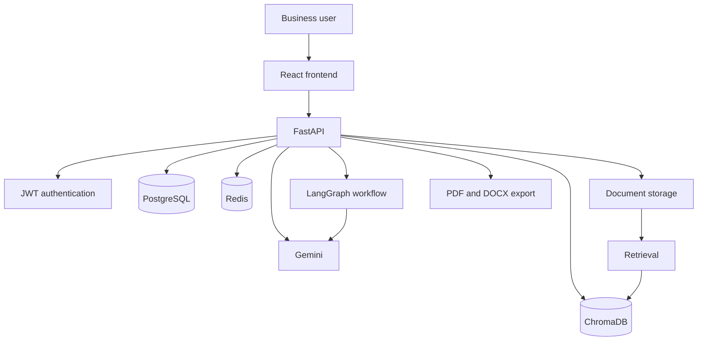

# Architecture

ProposalGenie is a multi-tenant web application. Each company is a tenant. Users see only the companies they belong to. A request for another company's proposal, document, or dashboard returns 404.



## Request path

1. The React app stores the access token in local storage and sends it as a bearer token.
2. FastAPI checks the signature, expiry, and `token_version`. Logout increments the version and invalidates older tokens.
3. Company membership is checked before proposal, document, cost, export, and dashboard queries.
4. Uploaded files are validated by extension and content, then stored under a server-generated key. The key is not returned to the browser.
5. Extracted text is chunked and upserted into the `company_knowledge` Chroma collection.
6. Proposal generation and the agent workflow call Gemini with retrieved excerpts wrapped as untrusted data.
7. Exports are written to the same private storage and downloaded only by a member of that company.

## Agents

| Agent | Responsibility |
| --- | --- |
| Requirement analysis | Summarize the request and missing inputs |
| Research | Read company evidence and optional external research |
| Solution architect | Propose components, stages, and risks |
| Proposal writer | Draft the required sections from that evidence |
| Quality review | Flag unsupported claims and request a bounded revision |
| Finalization | Save the draft, version, and status |

The review loop stops at `AGENT_MAX_REVIEW_ITERATIONS`. Run state is stored in PostgreSQL, not in process memory.

## Persistence

| Data | Location |
| --- | --- |
| Accounts, companies, proposals, costs, approvals, exports | PostgreSQL |
| Rate-limit counters and health checks | Redis |
| Uploaded documents and generated PDF/DOCX files | `DOCUMENT_STORAGE_PATH` |
| Embeddings | `CHROMA_PATH` |

Docker Compose mounts PostgreSQL, Redis, documents, and Chroma on named volumes. `alembic upgrade head` runs when the API container starts. It does not drop or reload data.

## Backup and recovery

1. Stop writes or take the backup while PostgreSQL is running with `pg_dump`.
2. Copy the documents volume and the Chroma volume with the dump. The three pieces belong together.
3. Restore by creating an empty database, running `pg_restore` or `psql`, then copying the two volumes back before starting the API.
4. Do not restore only the database. Document bytes and vectors would no longer match the rows.

Example, from the host while the Postgres container is running:

```powershell
docker exec proposalgenie-postgres pg_dump -U proposalgenie -d proposalgenie -Fc -f /tmp/proposalgenie.dump
docker cp proposalgenie-postgres:/tmp/proposalgenie.dump .\proposalgenie.dump
```

Keep the dump outside the git repository. It can contain customer proposal text.
